# VN Legal Radar

Automated Vietnamese legal and business news monitoring pipeline that aggregates RSS feeds from VnExpress, generates concise AI-powered impact summaries via OpenRouter, and delivers rich Embed notifications to Discord on a twice-daily schedule.

## Architecture & Data Flow

```mermaid
flowchart LR
    A["GitHub Actions (Cron 08:00 & 20:00 ICT)"] --> B["src/fetcher.py: Parse VnExpress RSS"]
    B --> C["Filter & Deduplicate via data/seen.json"]
    C -->|New articles <= 5| D["src/summarizer.py: OpenRouter AI (3 bullets)"]
    D -->|Fallback on error/missing key| E["Cleaned Original Description"]
    D --> F["src/notifier.py: Discord Embed Webhook"]
    E --> F
    F -->|Success| G["Update data/seen.json (max 200 links)"]
    G --> H["Auto-commit & push via github-actions[bot]"]
```



## Tech Stack

- **Language:** Python 3.11
- **RSS & HTML Parsing:** `feedparser`, `beautifulsoup4`
- **HTTP Client:** `requests`
- **AI Summarization:** OpenRouter API (`openrouter/free`) with automatic fallback
- **Notifications:** Discord Webhooks (Rich Embeds with rate-limit protection)
- **Automation & Storage:** GitHub Actions + JSON state tracking (`data/seen.json`)

## Local Setup & Dry-Run

1. Install dependencies:

   ```bash
   pip install -r requirements.txt
   ```

2. Run in `--dry-run` mode to fetch live RSS articles and preview Discord Embed payloads in the terminal without sending webhooks or modifying `data/seen.json`:

   ```bash
   python main.py --dry-run
   ```

3. (Optional) Test with your OpenRouter API key locally:

   ```bash
   export OPENROUTER_API_KEY="your_openrouter_api_key"
   python main.py --dry-run
   ```

## GitHub Secrets Configuration

To enable automated runs in GitHub Actions, configure the following repository secrets under **Settings -> Secrets and variables -> Actions**:

| Secret Name | Required | Description |
| --- | --- | --- |
| `DISCORD_WEBHOOK_URL` | Yes | Discord channel webhook URL for delivering news Embeds. |
| `OPENROUTER_API_KEY` | Optional | OpenRouter API key for 3-bullet Vietnamese AI summaries. Falls back to cleaned RSS descriptions if omitted. |
